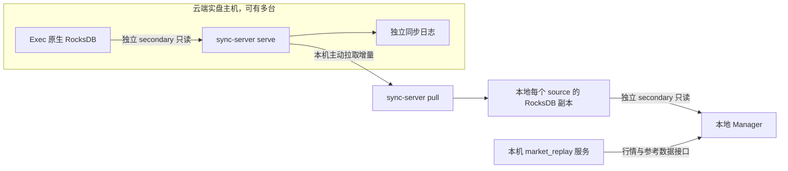

# 国内期货独立增量同步服务

2026-11-17。按操作员选择：Exec 留在云端，本机运行 `market_replay`、同步接收进程和
一个 Manager；多个实盘各自保留身份、断点与本地副本。此功能仅属于国内期货模式。



`sync-server` 是独立二进制、独立进程。云端运行导出角色，本机运行接收角色；Manager
只消费已提交副本。任何一方退出都不启动、停止或重启 Exec、交易 SDK 或 market_replay。
不复制正在写入的 RocksDB 文件，不迁走或删除线上原件，也不把订单落到 PostgreSQL。
同步进程不推断成交、策略身份或柜台状态，不承担下单、撤单和交易恢复。

## TOML 模式与合并边界

配置顶层明确指定 `mode = "cn_futures"`。国内 Manager 和 sync-server 都校验该字段；
传输请求、响应也包含同一模式，模式不一致时拒绝处理。公共枚举位于
`src/runtime_mode.rs`，Crypto 配置使用 `mode = "crypto"`，旧 Crypto TOML 未写模式时
仍默认 Crypto；现有 Crypto 读取与同步路径保持原样。当前 sync-server 不宣称已支持
Crypto 的列族或记录编码，合并时可按同一个模式字段增加对应适配器。

每个 source 使用全球唯一、长期稳定的 `id`，云端与本地完全相同。每个本地副本固定
为 `replica_root/<source_id>`，不同账户不共用游标、数据库或原生编号空间。
账户名称、部署路径和数组顺序不参与身份推断。添加新实盘只增加 source 配置，
不启动另一套 Manager。不把旧实盘的记录重新标成新实盘。

每个 source 的 `adapter` 显式设置为 `yida` 或 `ctp`，导出端和接收端保持一致。
两种柜台共享两个原生列族，可在一个导出器、接收器或 Manager 中混合配置；示例
配置的第一路为易达、第二路为 CTP。搬运保留原始字节、原生会话、开平和未知费用，
CTP 接入不需要同步进程或 Manager 加载任何交易 SDK。

## 云端导出角色

参考 `config/sync-server-export.example.toml`。一个进程可以读取同一主机多个 Exec。

```toml
mode = "cn_futures"
secondary_root = "/absolute/sync/secondaries"

[sync_export]
bind = "127.0.0.1:18212"
token_env = "CN_FUTURES_SYNC_TOKEN"
journal_root = "/absolute/sync/journals"
source_ids = ["cn_live01"]
batch_records = 500
batch_bytes = 4194304

[[sources]]
id = "cn_live01"
account = "国内实盘一"
adapter = "yida"
rocksdb_path = "/absolute/live/flow/persist_manager"
enabled = true
```

`source_ids` 是显式导出名单，不能包含关闭的 source 或接收型副本。云端只使用
独立 secondary 读执行库；`journal_root` 保存自己的哈希索引与追加修订日志。
它与执行库、secondary、行情缓存及 Manager 参考目录必须互不包含。
`serve` 不需要 PostgreSQL，默认数据库配置在这个角色下不会连接或初始化数据库。

Bearer 令牌仅从指定主机环境变量读取，至少 32 个非空白字节；示例只给变量名。
不得把令牌写入 TOML、URL、仓库或日志。默认只监听 loopback；跨机使用已有 SSH
隧道或经过认证配置的 TLS 入口。HTTP 客户端禁用代理与重定向。

```bash
cargo build --release --locked --bin sync-server --bin cn_futures_web
sync-server --config /absolute/export.toml check
sync-server --config /absolute/export.toml serve
```

接口为 `POST /api/native/sync/{source_id}`，仅返回授权名单中的原生记录。
无效令牌返回 401，未导出 source 返回 404，身份／断点冲突返回 409，读取失败返回
503。错误响应不携带执行路径、凭据或原始载荷。导出器没有修改执行库的接口。

## 本机接收角色与 Manager

参考 `config/sync-server-collect.example.toml`。它可由本机接收进程与 Manager 共用。

```toml
mode = "cn_futures"
secondary_root = "/absolute/manager/secondaries"
stale_secs = 60

[sync]
enabled = true
replica_root = "/absolute/manager/replicas"
poll_secs = 10
timeout_secs = 30
concurrent_sources = 4

[[sources]]
id = "cn_live01"
account = "国内实盘一"
adapter = "yida"
rocksdb_path = "/absolute/manager/replicas/cn_live01"
[sources.sync]
url = "http://127.0.0.1:18212"
token_env = "CN_FUTURES_SYNC_HOST_A_TOKEN"
```

不同实盘可配置不同 URL 和令牌变量；同一云端导出器的多个 source 也可以共用 URL。
`[sources.sync]` 明确标记本地副本，接收进程只写这种 source。副本路径必须与配置的
`replica_root/<source_id>` 相同，已有数据库还必须带本组件的所有权标记，避免把执行
库、其他账户或其他应用的数据库当成同步目的地。关闭 source 不读取、不同步。

```bash
# 纯配置校验：不读取令牌、不打开数据库、不发网络请求。
sync-server --config /absolute/local-manager.toml check

# 首轮全量与随后增量都使用这一入口；先单次验证，再作为独立进程常驻。
sync-server --config /absolute/local-manager.toml pull --once
sync-server --config /absolute/local-manager.toml pull

# Manager 单独启动，不会隐式拉起同步进程。
cn_futures_web --config /absolute/local-manager.toml --bind 127.0.0.1:18211
```

每个 source 独立轮询、失败退避和保存错误；失败不会终止其他 source，正常 source
不等待故障 source 的下一轮。并发上限由 `concurrent_sources` 控制。网络请求有配置的
超时，失败按指数退避，最大退避为 `max(poll_secs, 300)` 秒。首次配置错误需修正后
重启接收进程。SIGINT／SIGTERM 停止拉取并保留已落盘的断点，已接收批次可在重启后续传。

导出器按 source 复用一个同步日志句柄，分页不会重新打开日志或反复恢复 WAL。
接收器显式协商 gzip；导出器按 HTTP 标准压缩响应，接收器在后台解压、验证并应用。
压缩体和解压后的 JSON 都限制为 16 MiB，损坏或膨胀超限的响应不会推进断点。
`timeout_secs` 可设为 1–3600 秒，GB 级首次捕获可使用更长的独立请求超时；
该值不改变轮询周期，也不改变保存原始 key/value 的口径。

## 搬运的数据与一致性

| 原生列族 | 同步内容 |
| --- | --- |
| `cn_uniform_orders` | 订单生命周期、策略成交份额与内部对冲腿（只追加） |
| `cn_trade_updates` | 每笔交易所成交一条（只追加） |

原生 key/value 以 Base64 传输并校验 SHA-256，按原字节写入本地对应列族，不重新编码
浮点数或字符串编号。保留交易日、交易所、报单组、手数、开平、原生时间和所有身份。
同步不会凭订单数量、同名合约或时间相近建立策略归属。执行库与同步日志的身份被组合成
独立的同步世代标识；导出状态键为 `meta/head/v3` / `meta/pending/v3`，旧版状态不复用。

第一轮从零开始建立副本，完整核对固定只读视图中的两类记录。后续以原生数据库的
提交序号为断点，通过 secondary 读取原始 WAL WriteBatch，严格验证连续覆盖并仅取到
本轮固定视图的完整批次边界。CF ID 从真实句柄读取，不猜编号。按原顺序保存目标
列族的 put；两个列族都只追加，订单状态变化是新 key 的新记录。不以成交时间代替
存储变更序号。没有变化时直接确认同一源序号，不再扫描百万行。

WAL 不可用、不连续或包含无法完整解释的操作时，先丢弃未发布的临时尾部，再核对
完整固定视图。每轮增量的键数、键字节及操作数都有内存上限，超限也走完整核对。
不依赖 WAL 作为源端唯一持久副本。原生记录删除或覆盖已有 key（只追加冲突）、数据库身份改变、
提交序号倒退或目标列族被替换都拒绝继续，不清空历史或重新标记旧 source。

源端捕获日志分批同步 WAL。捕获中断时，未发布尾部在下一次恢复时丢弃；完整捕获
但尚未发布的批次会先完成哈希索引，再发布其边界。同步日志自身不自动清理，已有
副本的断点可能仍依赖历史；保留和备份需要独立规划。

接收端先冻结本轮源端目标水位，再分页接收，源端后续变化不会混入这轮。每页数据
与已接收游标在同一个同步 WAL 批次中落盘。连续序号、记录哈希链、断点哈希与源
世代都必须一致，避免复用错误游标、跳页或把重建／回滚的同步日志接到旧历史上。

分页接收期间，本地 Manager 继续读取上一个完整批次。接收完整后，接收进程拿独立
的读写屏障，标记 applying，再分批写入原生列族，最后提交整体水位并清理 staging。
Reader 在提交期间返回明确 503，账户观察页保留上次成功结果；崩溃遗留的 applying 会在
下次同步启动时幂等重放。不会让订单、成交和持仓快照的一部分先作为新结果展示。

每轮默认最多 500 条、约 4 MiB 一页，可提高到最多 10000 条，字节上限仍独立生效。
单条原始 key/value 合计上限 8 MiB，接收响应
上限 16 MiB。超过限制明确失败，不截断记录。传输水位与 native evidence sequence
是不同概念，不能据此推断成交、追平或交易可用。

## 数据时间与现阶段范围

账户观察与成本报告返回 `replication`：已提交／已接收／目标水位、源端已提交视图
时间、待提交视图时间、本地最近同步时间、最近尝试时间和错误。页面明确显示本地
副本；同步超过 `stale_secs` 或最近轮询失败时提示，不能用本地查询时间表示线上数据
已更新。断网时仍可分析此前完整同步的数据。

行情、合约、交易时段及参考费率继续由 market_replay 维护，不纳入订单复制协议。
账户实收手续费仍来自 Exec 事实记录。现有 market_replay 的参考数据 API 与 Manager
自动对接属于另一项接入工作；当前每日参考文件和 Kline 接口保留。

原生读取现支持易达及 CTP、六所期货，见[原生观察说明](native_futures.md)。同步不接入
Crypto 二进制订单格式。同步副本不是可用于启动交易进程的恢复目录。

## 本地验证

2026-11-17：格式检查、`cargo check --locked --all-targets` 和全量 Rust 测试通过
（668 项通过，37 项依赖特定数据库／基准环境的既有测试按原设置跳过）。11 项
SDK-free 同步测试覆盖多源隔离与故障恢复、字节一致性、旧订单和费用补充、固定批次
分页、断点恢复、应用中断恢复、源库身份变化、日志重建与断点哈希冲突、源记录消失
及不接管已有数据库；CTP 场景另外验证原生字节、未知费用、断线证据和重启续传。
测试只使用隔离 RocksDB 和 loopback 测试服务。部署前额外运行的 20 项隔离 PostgreSQL
HTTP／权限／当前 schema 测试全部通过。

`sync-server`、`cn_futures_web`、`cn_futures_reference` 和 `cta_web` 的 release 构建通过；
导出／接收两份 TOML 的 release `check` 与 Manager 双 source 配置校验通过，无网络、
令牌或数据库连接。国内和 Crypto 前端构建通过，lint 保留上游两个既有未使用声明
警告。验证日志保存在本机 Git 忽略的 `artifacts/native-sync-verify/`。尚未与真实云端
Exec 联调或部署，云端扫描耗时与同步频率需要在实际数据规模下测量。

## 已核对静态历史的断点维护

`adopt-source-checkpoint` 仅用于同步日志已完整核对、接收端已提交，而导出元数据尚未
保存原生 WAL 序号的情况。必须先停止导出器，提供**早于该核对批次**的源库文件
大小／mtime 基线和接收端已提交的游标／SHA-256。源文件必须从基线起完全未变，
基线时间、发布边界、接收哈希及列族身份均须通过；否则必须重新完整核对。
命令只原子补充本组件日志的断点元数据，不改 Exec、同步记录或业务事实。

```bash
sync-server --config /absolute/export.toml adopt-source-checkpoint \
  --source-id explicit_source_id --source-before /absolute/before.json \
  --cursor <receiver_committed_cursor> --sha256 <receiver_committed_sha256>
```
