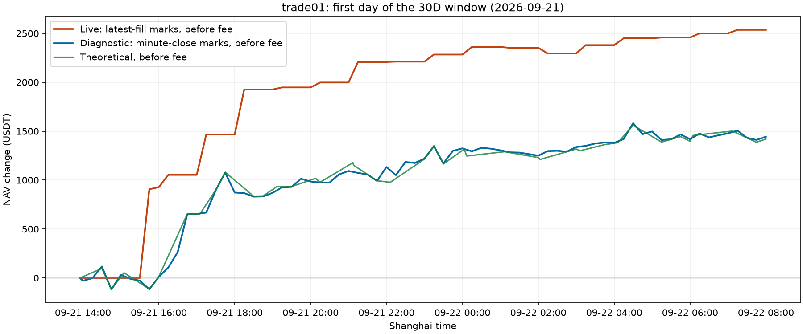

# el01 trade01 30D 首日净值跳变诊断

2026-10-21 经 el01 原有 Nginx 网关核对 `binance_exec_trade01`（bahll202210）。
操作员确认症状是 30D 的实际费前、费后曲线在第一天跳变。

根因是实际曲线使用最近成交价估值，而理论曲线使用已经完成的一分钟收盘价。
本次窗口起点的实际持仓仍沿用前一天的旧成交价。首日恢复成交时，持仓价格集中
更新，区间开始前已经发生的涨跌也被计入该窗口；在随后没有成交的时段，估值
再次停滞，直到下一笔成交集中反映。这同时影响费前、费后 NAV。

## 固定窗口及核对

读取窗口 `startMs=1789970112413`、`endMs=1792561212413`，即上海时间
2026-09-21 13:55:12.413 至 2026-10-21 13:40:12.413。起点留出十五分钟，
避开移动的 30 天 Kline 保留边界。API 请求显式限定该 source。

| 同一窗口 | 费前订单 NAV（USDT） | 费后订单 NAV（USDT） | 估算交易费（USDT） |
| --- | ---: | ---: | ---: |
| 实际 | 2,876.014900 | 2,825.084105 | 50.930795 |
| 理论 | 1,792.257597 | 1,675.382674 | 116.874923 |

理论截止上海时间 2026-10-21 13:36；实际最后成交早于该时刻，后续没有订单
NAV 变化。此表排除独立 funding。实际账户口径与策略归因口径的账户总数一致。
费前减费后等于交易费，逐点最大误差 `1.12e-12`。

把起点移到上海时间 9 月 22 日 08:00 后，余下约 29 天费前差只有
`17.405859` USDT（理论减实际，按接口相同截止时间），并非误差持续线性累计。

## 起点价格差

读取 Exec `uniform_orders` 和 Manager `klines_1m` 均使用 RocksDB 只读打开；
没有重新下载 Kline。下表分钟价为起点之前最后一个完整分钟的收盘价。

| 币种 | 起点持仓 | 旧成交估值 | 分钟收盘价 | 起点评价差（USDT） |
| --- | ---: | ---: | ---: | ---: |
| ETHUSDT | 4.55 | 2,575.56 | 2,666.21 | 412.4575 |
| SOLUSDT | 52.01 | 108.57 | 111.81 | 168.5124 |
| NEARUSDT | 229 | 3.716 | 4.32 | 138.3160 |
| BTCUSDT | 0.114 | 80,515.1 | 81,527.9 | 115.4592 |
| XRPUSDT | 1,485 | 1.3826 | 1.4306 | 71.2800 |
| 其余八个币种合计 | | | | 131.1682 |
| **总计** | | | | **1,037.193288** |

ETH 的旧成交发生在上海时间 9 月 20 日 20:02:20；下一笔成交为 9 月 21 日
15:44:34。其他活跃币种也在 15:44 左右恢复成交。AAVE 有一笔长期残余空仓，
其旧标价更早；仍按真实初始持仓纳入核对，没有删除或归到其他策略。

## 上线前分钟估值对照回算

从 API 起点持仓出发，独立按逐笔有符号成交数量重放：

`NAV(t) = Q(t) × Mark(t) − Q(start) × Mark(start) − Σ(成交有符号数量 × 成交价)`。

先使用原来最新成交价，复现首日所有 API 采样点的最大误差为 `9.10e-12`
USDT。再只将各时点的持仓估值改为缓存完整分钟收盘价，所有真实成交价、数量、
顺序及 API 的交易费不变。13 个币种的首日检查时点分钟价完整。

| 上海时间，对比前一个 15 分钟点 | 原实际费前变化 | 分钟估值对照变化 |
| --- | ---: | ---: |
| 9 月 21 日 15:45 | +906.788941 | −88.098334 |
| 9 月 21 日 17:15 | +412.845857 | +13.508536 |
| 9 月 21 日 18:15 | +459.397541 | −5.149530 |

检查首日截至上海时间 9 月 22 日 08:00，原实际费前/费后为
`2536.307740 / 2533.599075`；分钟估值对照为 `1443.597837 / 1440.889171`。
该对照与理论曲线接近，但没有强行将两条曲线对齐，也没有平移或裁剪图形。
首日内真实市场上涨仍保留。起点差与终点差共同决定整个窗口的重估差，不能
仅从每个点扣除一个常数。

诊断阶段保留了原来的最新成交价约定。操作员随后明确同意统一分钟估值，
实现及上线结果见下文。该变更同时覆盖起点、逐点、终点、账户/策略可加总性、
缺价状态，以及使用同一 NAV 的日权益重建，没有只修改 30D 图形。

## 诊断阶段操作与复现

- Manager PID 始终为 `3345516`，健康检查为 `ok`，无服务重启。
- 两次短期验证登录会话均在 `finally` 删除；凭据始终留在远端，未输出或存入仓库。
- 临时诊断可执行文件位于 el01 独立目录，检查后按精确路径删除。
- 没有修改快照、费用、配置、交易绑定、订单、目标或持仓。
- `src/bin/nav_cached_marks.rs` 是只读缓存核对工具，不发 HTTP、不创建 CF、不写数据库。
  release 构建通过，并在活跃 Manager 上验证读取。文件描述符上限设为 256，避免
  默认一次打开大量 SST 文件。
- 本地 `artifacts/nav_drift_20261021/summary.json`、`first_day_comparison.json`、
  `analyze.py` 保存数值、重放脚本和图片。原始 API JSON 与成交记录仅为本次本地诊断证据。

## 实现及 el01 发布

操作员批准后，将 Binance 实际区间 NAV 的持仓估值改为时点之前最后一个完整
分钟的收盘价。起点、采样点和终点共用该规则；真实成交价、数量、FIFO、已实现
盈亏和手续费保持不变。账户与策略仍按 source、symbol、venue 隔离，账户净持仓
为零但策略相互抵消时也分别估值。未分配仓位保留为独立归因。

实际曲线、单币种查询、策略汇总和 Arrow 导出使用同一估值口径，报告标记为
`quantity_fifo_closed_1m_window_delta`。日权益重建记录该估值口径，仍按原来的
每日调度更新，不强制重写已保存的当日记录。其他市场和纯订单离线诊断保留其
原有明确标记的最新成交价口径。

行情复用 Manager 的分钟缓存、并发合并、固定出口和原有 `120 weight/minute`
预算。缺价时返回明确的加载/不可用状态，不混入旧成交价；页面每十秒重试加载
中的同一查询。超出保留范围的自定义区间明确拒绝，30D 快捷区间按当前可用边界
对齐。没有增加 schema DDL、快照写入或 Exec RocksDB 写入。

发布 `20261021T065251Z` 使用现有工作区构建。manifest 记录 checkout
`82f58cb06436526b56c8d27718d507000ad640fb`、dirty 状态及实际源码/前端文件哈希；
不将此工作区构建描述为该提交的干净构建。`cta_web` SHA-256：
`5ec57e80799e3b53fda2ca2bf4a3e0c0b91c22e733e3919646a808e10390e796`。
仅重启 `crypto-cta-manager-web.service`，保留上个二进制和 webroot 以便回退。

发布时前端曾误放到 webroot 根目录，缺少 Nginx 所需的 `manager/` 子目录，
导致页面出现 `500` 和 `/manager/index.html` 内部重定向循环。API、Nginx 进程和
转发通道仍在运行。操作员报告后已补齐正确目录并保留旧哈希资源；入口
`/manager/`、`/manager/workspace/` 及新 JS/CSS 全部返回 `200`，哈希与构建包
一致。没有修改 Nginx 配置或重启 Nginx。发布脚本也已修正目录结构。

## 上线核验

固定验证窗口为 `1789976400000000` 至 `1792565280000000` 微秒，首日检查截止
`1790035200000000`。该窗口与最初诊断窗口不同，数值不可直接混用。

| 同一固定窗口 | 上线前费前/费后 NAV | 上线后费前/费后 NAV |
| --- | ---: | ---: |
| 约 30 天 | 2815.719495 / 2764.780443 | 1911.325530 / 1860.386478 |
| 首日 | 2536.307740 / 2533.599075 | 1533.244057 / 1530.535392 |

- 14 个启用账户的固定一日查询全部返回 `200`。逐账户成交数、成交额、maker/
  taker/未知角色明细、已实现盈亏和手续费均与上线前一致；曲线端点等于汇总，
  逐点费前减费后等于手续费。首次缺价补齐后，活动补齐任务归零、行情错误为空。
- 独立使用真实逐笔成交和只读分钟缓存重放首日 67 个点，与上线后曲线最大误差
  `1.01e-11` USDT。四个策略导出汇总与页面最大误差 `5.83e-11`；首日策略含
  未分配仓位逐点加总误差小于 `6.83e-13`，30D 终点加总误差小于 `3.64e-12`。
- 起点零长度查询为零；单币种查询成功；超出分钟保留范围返回明确 `422`。
  理论曲线的 1,573 个共同时间点完全不变，已补齐的最新分钟使终点向后推进一分钟。
- 88 个受保护进程的 PID/启动标识、16 份配置哈希、四张快照表的行数/内容哈希
  均不变；Manager CPU 仍为 `0-7`。目标索引已就绪，处理 4,282,917 条消息。
- 14 个账户原有资金费数值在冷缓存加载完成后保持一致。固定 30D 实际查询再次
  执行得到相同结果，行情请求计数 `1060 → 1060`，没有重新下载缓存分钟。
- 真实 Chromium 桌面 `1440×1000` 和手机 `390×1100` 检查通过：30D 起点对齐、
  费前/费后及两条理论曲线均绘制，无 JS 错误或页面横向溢出。模拟一次缺价 `503`
  后，页面显示补齐状态并在十秒后自动恢复；随后总览路由加载成功。
  核验结果见 `browser_pending_result.json`，截图为 `live_1440.png`、`live_390.png`。
- `cargo fmt --check`、`cargo check`、全量 `cargo test` 和 release 构建通过。
  Rust 共 388 项通过、20 项按既有条件忽略；前端构建及 23 项 Node 测试通过。
- 验证使用的短期登录会话均在 `finally` 删除，凭据未输出或写入文件。数值核验
  保存于本地 `artifacts/nav_drift_20261021/deployment_validation.json` 和
  `independent_live_comparison.json`，入口资源哈希见 `public_assets.json`。
