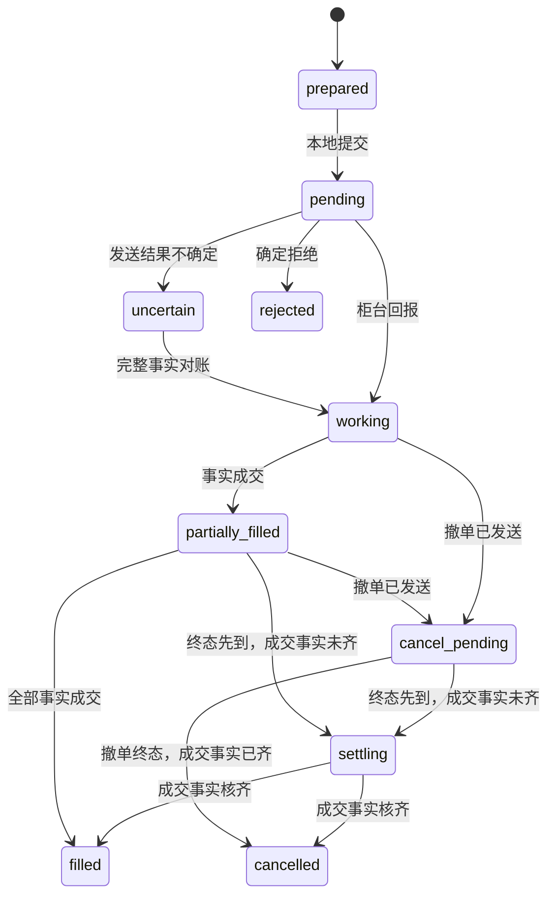

# 国内期货 CTA 管理与观察

最后更新：2026-11-17 UTC。

`cn_futures_cta_manager` 从 `crypto_cta_manager` 的 `757ea71` 建立共同历史的本地 fork，分支为 `cn-futures`，`upstream` 指向原 GitHub 仓库。未改包名和既有 Crypto API；新增原生入口、读取器和页面集中在 `src/native_futures/`、`src/bin/cn_futures_web.rs`、`frontend/src/native/`。当前尚未创建或推送独立 GitHub `origin`。

本阶段支持易达、CTP 的账户目录、今昨／多空持仓快照、委托、事实成交、策略目录和授权，读取范围包括 SHFE、INE、DCE、CZCE、CFFEX、GFEX 六所。使用原 Manager 的登录、密码／会话实现、账户授权和私有策略目录表。国内 Manager 必须使用独立 PostgreSQL 数据库、凭据变量与 secondary 目录。Cookie 名为 `cn_cta_session`，与 Crypto 的 `cta_session` 分离。

2026-11-17 默认部署方向调整为本机一个 Manager 管理多个云端实盘，云端独立
`sync-server serve` 只读导出，本机独立 `sync-server pull` 增量写入专用副本；见
[国内期货增量同步](cn_futures_sync.md)。TOML 显式配置 `mode = "cn_futures"`。
原直接读取方式继续可用，Crypto 旧配置默认 `crypto`，不自动启动同步进程。

2026-11-14 新增自建 Binance 兼容 Kline HTTP 接入、本地每日参考数据维护、分钟 TWAP／VWAP 和真实成交成本对照，
见[行情参考与成本复盘](native_reference_cost.md)。参考文件与执行数据库隔离；
成本对照不建立策略事实归属，也不代表已实现国内净值或结算盈亏。

观察进程不加载 SDK、不访问交易柜台，不发目标、不报撤单。策略目标单位为**整数手**，键为 `SHFE:cu2612`、`INE:sc2612P640` 等，保留原生大小写。正数为多仓、负数为空仓。保存只更新目录；没有执行发布或自动下单路径。未接入策略事实身份前，不能因为订单曾本地提交或合约与策略目标相同而推定成交归属。

## 配置与构建

复制 `config/cn-futures-manager.example.toml`，配置每个账户／执行部署唯一的 `id` 和执行进程 `flow/persist_manager` 的绝对路径。`secondary_root` 与所有执行数据库路径必须互不包含，校验会解析已有路径和父目录的符号链接。关闭的数据源不授予读取权限。可用 `source_viewers` 对管理员同样施加主机级可见性边界。

每个 source 必须显式配置 `adapter = "yida"` 或 `adapter = "ctp"`；同一 Manager 可混合读取，
同步导出端与接收端应使用相同配置。CTP 复用相同三类原生列族，不加载 SDK。
会话保留 `ctp:<front_id>:<session_id>`，不截取 OrderRef 或合并不同会话；未知手续费和
币种保持空值。合约保留原生大小写和月份：例如 `DCE:m2701`、`CZCE:SR701`、
`CFFEX:IF2612`、`GFEX:lc2701`，不把郑商所三位月份扩展为四位或改为主连。
策略目录继续接受已有 SHFE / INE 期权格式；目录保存不表示柜台支持执行该合约。

```bash
cargo build --release --bin cn_futures_web
cargo run --bin cn_futures_web -- --config /absolute/cn-manager.toml --check-config

# 只读执行库；不需要 PostgreSQL 或交易凭据。
cargo run --bin cn_futures_web -- --config /absolute/cn-manager.toml --snapshot

# 仅对独立、新建的空 Manager 数据库显式初始化。
# CN_FUTURES_CTA_DATABASE_URL 从仓库外的主机凭据环境读取。
cargo run --release --bin cn_futures_web -- --config /absolute/cn-manager.toml --init-db
cargo run --release --bin cn_futures_web -- --config /absolute/cn-manager.toml --bind 127.0.0.1:18211

cd frontend
npm ci
npm run build:cn-futures
# npm run build 继续构建上游 Crypto 页面。
```

HTTP API 只监听 loopback，前端保留 `/manager/` 和同源 `/manager/api/` 网关约定。本机 PM2 运行 Manager 和接收器，经 SSH 反向转发及腾讯云既有 Nginx 提供网页；云端单独运行只读导出器。具体路径与启停方式见[部署说明](cn_futures_pm2.md)，不要使用复制来的 Crypto 生产部署脚本操作国内环境。

## 读取与事实边界

只读原生列族 `cn_trading_events`、`cn_uniform_orders`、`cn_trade_facts`。每个 source 复用独立的 Manager secondary，将 catch-up 和跨列族读取串行化；RocksDB secondary 不支持 `snapshot()`，读取中不再次 catch up。执行 primary 可以一直保持打开和写入。近期订单／成交响应有上限，内存不保留全部原始记录；每个 source 独立读取，故障不会阻断其他账户。API 返回经过授权的数据，不暴露原始审计载荷、账户哈希、SDK 路径或交易凭据。

观察结果使用有界内存缓存：没有新提交时只更新查询时间、过期状态及同步元数据；有变化时读取 WAL，追加投影新证据，并仅重读变化的订单／成交列族。单独手续费修订仍会刷新成交。旧证据修订、WAL 缺口或不支持的操作触发完整重算，数据库身份或列族替换使缓存失效。首次读取仍需扫描已有证据。副本的 apply 锁只在单次查询内持有，不能因长期复用 secondary 而阻塞后续同步提交。成本查询复用相同固定读取视图。

`state_observed_us` 是持仓快照的实际观察时刻，`last_event_us` 是最后证据时刻，`read_at_us` 只是查询时刻。晚于快照的成交令 `positions_may_lag=true`：继续标明旧快照，而不据不完整回报重建今昨仓或冻结。瞬时查询失败时页面保留上次结果并明确标记，不将旧数据装成新读数；认证失效或权限撤销则清除对应缓存展示。

`available_local_budget` 只是执行核心的保守本地可用预算，不是账户权益或实时保证金。国内页面不按 maker/taker 分类；理论手续费统一按合约及开仓、平仓、平今、平昨规则计算。实际手续费直接保留事实值和币种，未报告保持空，不用估算费用回填。合约乘数、开平、订单类型、原始发送状态和完整身份留在订单原记录中。`native_time` 按柜台原生整数展示，不转换为 Unix 时间。未实现国内保证金、结算盈亏、净值、交易日历或自动换月，不以 Crypto 的 USDT、自然日或资金费率逻辑代替。

## 状态机对齐

执行端是订单／仓位状态的唯一维护者。Manager 的 `phase` 是读取投影，不触发下单、重试、释放冻结或账本校正。保留原始 `send_state`、`order.status`、`filled`、`reported_filled`、`cancel_pending`；上游 Crypto API 的状态字段保持原状。

连接状态分别解释两种柜台的原始证据。CTP `kind=1/2` 表示连接／断线；`kind=14`
是查询成交、`kind=16` 是可能重试的请求错误，不按易达的失效／致命事件解释。
`recovery_checkpoint` 仍处于恢复中，只有后续状态／`reconciled` 才能更新就绪快照；
`restart_required` 显示阻断。观察到连接恢复不会自动把旧快照标成已追平。

CTP 的 Manager 回归使用合成 JSON、隔离 RocksDB 和 loopback 同步 HTTP，覆盖六所、
原生会话、未知费用、断线恢复、增量搬运及同步重启；不代表新增实盘成交验收。
2026-11-17：完整测试（682 通过、37 按原设置忽略）通过，
`cargo fmt --check`、`cargo check --locked --all-targets` 和国内前端构建通过。
`cn_futures_web`、`sync-server`、`cn_futures_reference` 的 release 构建及 YD／CTP
混合来源示例的导出、接收、Manager 纯配置校验通过，未连接柜台。
部署前已另建隔离 PostgreSQL，20 项显式集成测试通过（原生 HTTP／权限／静态网页 1 项、
当前 schema 及显式维护 19 项）；测试集群只使用专用 socket 和临时测试数据库。
复用 secondary 和观察缓存改动后，隔离 PostgreSQL 的原生 HTTP／权限／静态网页集成测试再次通过。
PM2 的生产网页与进程部署方式见[部署说明](cn_futures_pm2.md)。

| 观察状态 | 事实依据 | 不能据此推断 |
| --- | --- | --- |
| `prepared` | 已记录发送意图 | SDK 已发送或柜台已接受 |
| `pending` | 本地提交，等待订单回报 | 已挂入交易所 |
| `working` / `partially_filled` | 工作委托及事实成交量 | 剩余数量一定可撤 |
| `cancel_pending` | 已发送撤单，尚无确定结果 | 已撤单或可释放预占 |
| `settling` | 已见订单终态，但 `filled != reported_filled` | 已收齐成交事实 |
| `filled` / `cancelled` / `rejected` | 相应终态且事实成交量已核齐 | 本地拒绝等于柜台拒绝；详见原始发送状态 |
| `uncertain` | 发送结果不确定 | 查询未发现就等于未发送，或可自动替代下单 |



该图只展示主要观测路径，不对回调顺序施加额外假设。完整身份为 `(source_id, trading_day, venue, session, order_ref)`；其中非零报单组属于原生 session。不能只按数字引用或系统号跨市场合并。成交保留 `(source_id, venue, symbol, trading_day, trade_id, side)` 及原生系统订单号，所有 64 位编号按字符串传输。

账户已收到初始化完成不代表追平。完整 `reconciled` 快照只证明该时刻账户恢复完成，不能独自证明交易通道、持久化屏障和执行开关全部就绪。观察接口分别保留 `snapshot_ready`、`transport_ready`、`reported_can_trade`，后两者未报告时为空，不由前者推导。所有字段都受快照时刻限制。`snapshot_current_runtime` 标明快照是否属于最新进程；新 runtime 晚于旧快照时显示 `recovering`，不沿用旧进程的交易就绪或通道事实。快照之后出现的断线、显式阻断、重新对账和通道事件按序号覆盖旧观察状态；通道另带 `transport_observed_us`。停止记录优先显示 `stopped`。投影错误、阻断原因和证据过期分别保留。Manager 对自己的执行能力固定报告 `execution_enabled=false`。

后续合并执行功能时，继续以执行端完整恢复和持久化确认为准；目标目录、已发布目标、执行中目标、事实仓位、未决报撤必须分别表示。不要新增一套可由 Web 确认“已成交／已撤单”的执行状态机，也不要把净仓为零视为多空／今昨仓均为零。

## API 与验证

复用 `/api/auth/status|register|login|logout|users`。账户授权独立于策略授权：策略配置权不授予账户数据访问，撤销账户授权在下一次请求生效。

| 路径 | 操作 |
| --- | --- |
| `/api/native/sources` | GET 已授权账户，无存储路径 |
| `/api/native/sources/{id}/snapshot` | GET 独立账户观察结果 |
| `/api/native/sources/{id}/cost?trading_day=YYYYMMDD` | GET 完整交易日的真实成交成本对照 |
| `/api/native/sources/{id}/grants` | GET / PUT 账户查看／配置授权 |
| `/api/native/strategies` | GET 可见策略，POST 创建／保存管理配置 |
| `/api/native/strategies/{name}/grants` | GET / PUT 私有策略授权 |

自动化覆盖本地提交与成交区别、撤单待确认、终态先于成交、部分成交后撤销、发送不确定、跨市场／报单组身份、64 位编号、活动 primary 持续写入、快照滞后、恢复与停止状态、损坏证据及 secondary 路径隔离。集成测试只接受独立的 `/tmp/cta-schema-test-*` Unix socket 的 PostgreSQL `15433`；验证匿名拒绝、管理员也受可见性边界限制、源授权立即撤销、私有策略和配置授权、整数手数及执行库记录不变。它不加载任何 CTP／易达 SDK。

```bash
cargo fmt --check
cargo test --locked
# 只在自行建立的隔离测试集群中执行：
CTA_SCHEMA_TEST_SOCKET=/tmp/cta-schema-test-EXAMPLE/socket \
  cargo test --locked --test native_manager -- --ignored
```

后续合并建议先向上游提交共用层的小改动（共享请求函数、按市场验证后的策略存储），再合入独立原生模块与构建入口。不要批量重命名 Crypto 类型或复制一套版本化内部 API。保留源库的历史和审计文档，国内运行配置与生产地址不从 Crypto 环境继承。

2026-11-13 本地验证完成：550 项常规 Rust 测试通过，另在独立 PostgreSQL 集群完成 1 项完整 HTTP／权限联测；原有 32 项需特定环境或显式基准的测试仍保持跳过。新增 9 项原生状态／读库回归通过，release 构建、格式检查、Crypto 与国内两种前端构建通过。前端 lint 仅有上游两个既有未使用声明警告。

用 release 程序直接读取同日 SDK `1.502.55.35` 官网公共仿真的真实执行库，得到交易日 `20261112`、17 笔订单、10 笔事实成交，观察状态为 10 笔 `filled`、7 笔 `cancelled`。保留原有 30 条非零持仓，`cu2612` 测试仓归零，快照属于最新进程且已追平，无成交滞后或投影错误；进程状态为 `stopped`。读取前后执行库全部 14 个文件 SHA-256 不变。此样本的交易为 SHFE `cu2612`，同时包含 SHFE / INE 的既有持仓，不构成新版 INE 报单或期权执行验证。本地观察回执在 Git 忽略的 `artifacts/native-verify/receipt.json`，没有部署或启动常驻 Web 服务。
