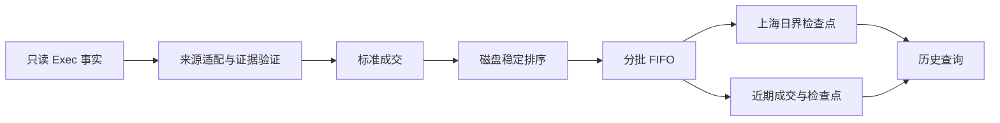

# 成交 FIFO、日界检查点与近期缓存

所有来源采用同一套分批重建、日界恢复和近期增量规则。构建无需按主机或
后端选择功能开关。来源适配器负责解析和验证成交，FIFO 只消费实际成交。

## 成交输入与隔离

- 从 Exec RocksDB 只读读取事实。`amount_update > 0` 表示本次成交的基础币
  数量；零成交生命周期不进入排序、FIFO 或常驻成交序列。负数与非有限数值
  仍须校验报错，不能借过滤跳过损坏事实。
- 按 `source_id`、symbol、event venue 隔离 FIFO，账户与策略分别计算后汇总。
  cash 与 perpetual 不互相平仓；账户净仓为零仍保留互相抵消的策略持仓。
- 按 `update_ts_us` 排序，以接收时间及 RocksDB 记录键稳定处理同时间成交。
  累计成交量不能当作每条独立成交反复累加。
- 成交角色优先使用事实 `is_maker` / `execType`，没有原始角色时才使用既有
  后备规则。仅保留成交属性及 Maker/Taker/Unknown 笔数、成交额和费用汇总，
  不常驻完整交易回报。负费率仍表示返佣，内部交叉手续费为零。
- 小型目录元数据单独保留各市场代表记录及最早订单创建时间，供 symbol 索引
  和资金费历史起点使用；不能用裁剪后的首笔成交改写完整历史的起点。

## 证据关联

需要补价、去重或补充角色的来源使用 Manager 自有的可丢弃磁盘索引。
RapidX 适配器关联生命周期、`rapidx_executions` 和账户角色 journal，按
portfolio、exchange、symbol、venue、方向及订单/成交身份验证。
同一 transaction 的 WS/REST 事实去重；已有完整、有价成交保留原价、数量、
时间与策略归属。角色只作用于证据覆盖的数量，混合角色逐笔对应。

execution 的 hash key 不代表时间。适配器每轮流式核对内容指纹，只重新关联
发生变化的订单，不能把最大 hash key 当作增量时间游标。journal 按字节位置
增量读取完整行，处理换文件、截断和未完成尾行；没有新生命周期时，晚到的
成交或角色证据也须生效。身份、价格或数量不完整的恢复成交不能作为事实
推进；缺少角色时保留 Unknown 并沿用既有估费规则，不能伪造已确认角色。

索引位于 Manager DB 父目录的 `run/nav-recovery/`。每份报表持有不可变成交
视图，旧查询不能看见后来更新的事实；没有读者的旧投影可回收。索引可从
Exec 重建，不是第二份永久订单历史，也不向 PostgreSQL 复制订单。

## 分批重建与近期刷新

冷启动和必须完整重算的刷新按 source 顺序处理：

1. 流式读取并验证成交，写入 Manager 自有的 `run/nav-replay/` 磁盘排序区。
2. 依稳定成交顺序回放，每批最多 4096 笔、4 MiB；同时推进账户和策略 FIFO。
3. 持久化经过的上海日界状态，释放已完成日的旧成交与中间状态。
4. 仅保留最近七天（上海日界对齐）的成交、有限近期检查点和必要未平仓批次。

近期普通新增成交增量追加；乱序成交、被替换成交及角色修正从最早受影响的
近期检查点重放。变化早于内存窗口、输入前提发生变化或增量超过批次预算时，
进入同一个分批完整重建路径，不先积攒全历史或完整差异数组。

每次进程重启保守重建，防止停机期间的旧事实修正污染已存状态；跨重启验证
水位后直接恢复尚未实现。当前 API 仍等待首次重建完成后启动。

## 日界状态

使用 host-global ManagerDb 的 `nav_fifo_daily` CF：

- 键为 `source_id UTF-8 || 0x00 || boundary_ts_us 的 8 字节大端编码`。
  source ID 非空且不含 NUL，日界为上海时间 00:00，以 UTC 微秒记录。
- 一个值原子保存账户与策略状态，包含完整的有序 FIFO lots、实现盈亏、
  成交量、费用、角色统计、最近成交估值、初始参考价和归属修正位置。
- 保存安全起扫 receive key、CF 读取上限、Exec identity、快照/归属/费率
  指纹、覆盖范围及完成标记。日界时间不能直接充当接收键过滤条件。
- 严格早于日界的成交计入该检查点；恰好日界的成交由后一天消费。
  PostgreSQL 初始快照继续使用 after-events 语义。
- 日界值使用 MessagePack 精确保留 f64。不可变归属指纹保持原有 JSON 数字
  解析语义；日界编码不依赖全局 JSON 功能开关。仅维护一种当前格式。

日界是可重建的派生状态。完整重建先使旧日界失效，再写入当前输入的状态；
不修改初始仓位快照、原始订单历史或保存的归属指纹。不完整或输入指纹不符
的检查点不能用于查询。重建失败保留上一份成功报表，不拼接新旧事实曲线。

## 历史查询与估值

查询 `[start,end]` 时，按 source 选择不晚于 start 的有效日界，重放到 start
取得基准，再处理到 end。日内采样不能用日末净仓替代，各日不能分别归零后
拼接。读取使用报表自己的冻结事实视图与水位，保持并发查询的一致性。

相同查询共享计算，历史回放受并发预算限制；完成后释放历史成交和查询结果。
近期请求最多缓存四个结果及四份分钟价格计划。Linux/glibc 在历史回放预算锁
释放前尝试 `malloc_trim(0)`，归还已释放的分配器空闲页。

60D、90D、ALL 不裁短。超过 Kline 保留范围的整条曲线使用已标识的成交价
估值，日权益审计仍严格要求分钟价。账户、策略、资金费与导出使用相同恢复
状态；日界状态本身不缓存外部 Kline 估值。

## 资源边界与验证

排序区与证据索引各自使用 8 MiB 写缓冲、最多两个缓冲、8 MiB block cache
及最多 64 个打开文件。角色行/生命周期单条大小另有 8 MiB 限制。正常析构
清理专用目录，后续开启清理已退出进程的遗留目录，保留活动读者的目录。
Exec RocksDB 始终只读。

这些预算约束重建批次与磁盘关联缓冲，不构成整进程 RSS 上限。跨越七天的
未平仓 FIFO lots 不能按年龄删除，近期成交、报表、目标索引和在途请求仍
占用内存；长窗口查询仍会加载其所需的成交范围。

实现入口为 `src/nav/daily.rs`、`src/nav/daily/rebuild.rs`、
`src/nav/fill_recovery/store.rs` 和 `src/nav.rs`。回归测试对照完整重算，
覆盖账户/策略曲线、现金/永续、跨日持仓、乱序/晚到成交、混合角色、WS/REST
重复、角色日志轮转、失败重试、不可变视图、投影回收及进程重建。生产验收
比较固定窗口的实际成交、角色、费用、实现与浮动盈亏，避免将缓存或公共
资金费覆盖变化误记为成交差异。
